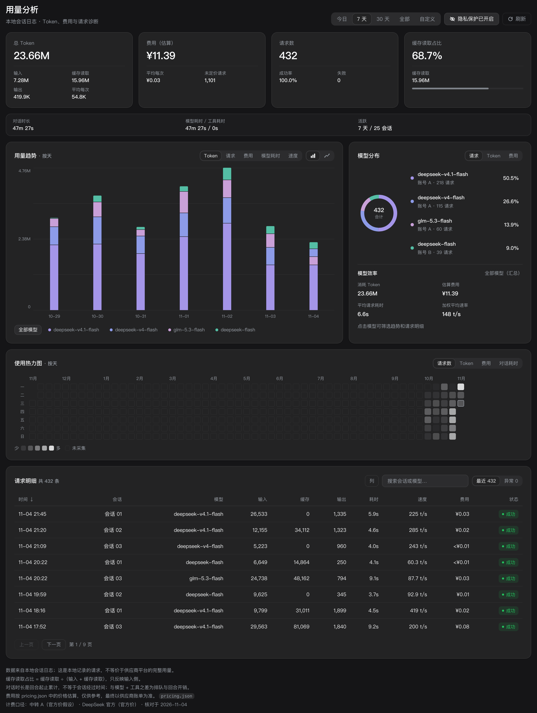
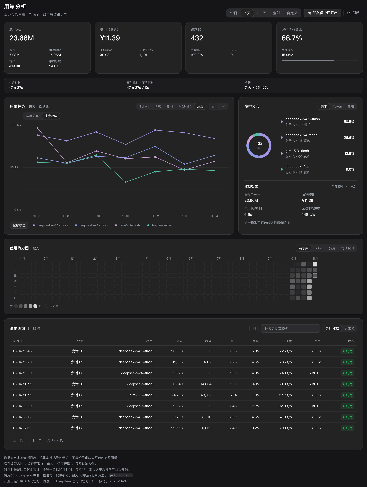
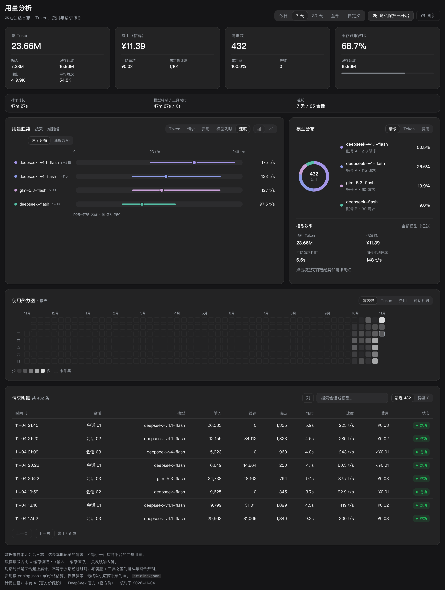

# TokenLens · Usage Lens

**Turn DeepSeek Harness session logs into a usage and cost dashboard you can actually read.**

Tokens, requests, cache hits, cost, model speed, conversation time — all computed from local logs. No network, no uploads, no API key.

[中文](README.md) | English

[](LICENSE)
[](#development-and-packaging)
[](https://github.com/muxili87-art/dsh-token-lens)
[](#privacy-mode)



---

## Why you want it

Harness records your session logs but never tells you:

- how many tokens you burned today / this week / this month, and what it cost;
- how much you hit the cache — **10 points of cache-hit rate can halve or double the bill**;
- which model eats the budget, and which requests silently used a premium tier;
- whether output speed (tok/s) is fine or the P50 has collapsed;
- which days were productive and which were idle.

This plugin answers all of it at once: one click in the sidebar for trends, a heatmap, the model mix and the full request log.

## Features

| | |
|---|---|
| **Multi-range overview** | Today / 7 days / 30 days / All time / custom range, with KPI cards for direct comparison |
| **Trend charts** | Five metrics: tokens, requests, cost, model time, output speed; bar/line toggle; hover and model filtering |
| **Automatic granularity** | Today → hourly; 7/30 days → daily; longer ranges switch to weekly (Monday-anchored) or calendar monthly, so the chart never collapses into one bar |
| **GitHub-style heatmap** | One cell per day for the last 53 weeks, colored by requests/tokens/cost/time; click a cell to filter that day |
| **Model mix** | Ranked colored share bars per model, one click on the legend to filter |
| **Speed panel** | Speed distribution (P25/P50/P75 ranges) and a speed trend chart for fast multi-model comparison |
| **Searchable request log** | Sort by time/duration/tokens, filter by model and keyword, separate view for failed requests |
| **Privacy mode** | One click hides session titles, accounts, error details and sensitive model names; every number stays identical — safe for screenshots and issues |
| **Peak/off-peak pricing** | Estimates cost with separate peak/off-peak rates on Beijing-time weekdays; third-party relays can be assumed at official prices |

The panel follows the Harness language setting (Chinese / English).

## Screens

### Model time (all models: stacked segments, same width as the token chart, no horizontal scrolling)


### Speed trend (lines for multi-model comparison; switch to bars after filtering one model)



### Speed distribution (P25 / P50 / P75)



## Install

Requires the DeepSeek Harness desktop app (developed and verified on `0.2.1-rc.5`).

1. Download `dsh-token-lens-<version>.zip` from [Releases](https://github.com/muxili87-art/dsh-token-lens/releases) and unzip it anywhere; note the **absolute path**;
2. In a Harness session run:

```text
plugin_manager install_bundle target=<absolute path to the unzipped folder>
```

3. Quit DeepSeek Harness completely and reopen it (the first load or a replacement must restart so the browser-side client modules are rebuilt);
4. The **Usage Analysis** icon appears in the sidebar.

Data is computed automatically: the plugin scans `~/.dsh/sessions` in the background, folds it into per-day buckets and caches the result in `~/.dsh/usage-dashboard/cache.v1.json`, then only refreshes incrementally.

### The app will not start after installing

**Do not use the v1.0.0 zip**: its `package.json` was missing `exports["./client"]`, so the Harness startup scan throws and the whole plugin assembly fails — the app cannot boot. Upgrade to **v1.0.1 or newer**.

If the app still will not start, work through this order:

1. From the plugin folder run the self-check:

```bash
npm run doctor
```

   `✗ declares dsh.client but package.json has no exports mapping` is exactly the bug above (use v1.0.1+);
2. Uninstall, then reinstall: delete `~/.dsh/profiles/<profile>/node_modules/dsh-token-lens` and its row in `cordis.patch.yml`, restart to confirm the app recovers, then run `install_bundle` again;
3. If it still fails, send the startup log lines beginning with `client-modules:` to [Issues](https://github.com/muxili87-art/dsh-token-lens/issues).

### Windows notes

The plugin is platform-independent (all paths go through `homedir()` / `path.join`; no OS-specific code). If Harness **launched from a terminal** silently exits on Windows, it is usually not the plugin: the environment frequently carries both `HTTPS_PROXY` and `https_proxy` (duplicate in different case). Drop one of them, or just launch from the desktop icon.

## Privacy mode

With privacy mode on (top-right toggle):

- session titles → `Session 01`, `Session 02`, … (stable mapping within one open, so you can still correlate);
- accounts → `Account A`, `Account B`, …;
- error messages and search keywords → hidden;
- sensitive model names shaped like `/Users/...`, `https://...`, `sk-...` → `Model hidden`.

**Numbers, charts and costs do not change at all** — so screenshots can go straight into a chat or an issue.

> The plugin only reads local session logs and computes everything locally; it makes no network requests. The screenshots in this README were rendered with privacy mode on and demo data.

## Pricing (`pricing.json`)

Cost estimates come from `pricing.json`; restart after editing:

```jsonc
{
  "peak": {                       // peak windows (Beijing time)
    "offsetMinutes": 480,
    "weekdays": [1, 2, 3, 4, 5],
    "windows": [["09:00", "12:00"], ["14:00", "18:00"]]
  },
  "books": {                      // price book, in CNY per 1M tokens
    "deepseek-flash-2026-11": {
      "models": {
        "deepseek-flash": {
          "offPeak": { "cacheHit": 0.02, "cacheMiss": 1, "output": 4 },
          "peak":    { "cacheHit": 0.04, "cacheMiss": 2, "output": 8 }
        }
      }
    }
  },
  "providers": {                  // provider -> price book
    "official": {
      "label": "DeepSeek official",
      "book": "deepseek-flash-2026-11",
      "source": "official",
      "models": { "deepseek-flash": "deepseek-flash" }
    },
    "relay": {                    // rename to your own provider key
      "label": "Third-party relay",
      "book": "deepseek-flash-2026-11",
      "source": "assumed-official",
      "models": { "deepseek-v4.1-flash": "deepseek-flash" }
    }
  }
}
```

Key points:

- the key of `providers.<p>` must match the `provider` half of `provider/model` in your session logs, otherwise those models show as *price unconfirmed*;
- the key of `books.<b>.models.<m>` is the **model name** (the part after `provider/`);
- models with only an `offPeak` tier (e.g. some third-party models without peak pricing) use that tier in peak hours too;
- historical requests priced before `effectiveFrom` are flagged in the footer instead of being guessed.

## Metric definitions

| Metric | Definition |
|---|---|
| Total tokens | `input + output + cacheRead + cacheWrite` |
| Requests | Model requests that were sent successfully (failures counted separately) |
| Cache-hit rate | `cacheRead / (cacheRead + input)` |
| Cost | `cacheRead×cacheHit + (input+cacheWrite)×cacheMiss + output×output`, using the peak/off-peak tier and the provider mapping |
| Model time | Average LLM duration of that model's requests (tool calls excluded) |
| Output speed | `output tokens / (duration ms / 1000)`, sampled per request, then P25/P50/P75 |

## Trend granularity

| Range | Granularity |
|---|---|
| Today | hourly |
| 7 days / 30 days | daily |
| All / custom | span ≤1 day → hourly; ≤45 days → daily; ≤315 days → weekly (Monday-anchored); longer → calendar months |

Weekly buckets run from the first Monday in the range to the last; monthly buckets follow the calendar month in the statistics time zone; the speed P50 is recomputed from request-level samples inside each bucket — it is not an average of daily P50s.

## Data source and accuracy

- The **only** data source is `~/.dsh/sessions/<workspace>/<session>/session.v*.jsonl.zstd`; the plugin only reads it, never writes;
- Numbers describe **locally recorded usage** and can differ from provider bills (retries, failed requests, cache billing rules, free tiers);
- "Seeded" requests of forked/copied sessions are de-duplicated so the same history is not counted twice;
- The cache file can be deleted at any time; the next open rebuilds it from scratch.

## Development and packaging

Zero runtime dependencies (Node built-ins and Harness-shipped packages only):

```bash
npm run check    # syntax check for the three JS files
npm run doctor   # validate the bundle contract (dsh.client / exports / patch row name / module id)
npm run verify   # both of the above
npm run pack     # build dist/dsh-token-lens-<version>.zip
```

> `npm run doctor` mirrors the host's `client-modules` startup validation. **It must pass before release**:
> if `dsh.client` is declared without `exports["./client"]`, Harness throws
> `declares dsh.client but exports no "./client" bundle`, the plugin assembly fails and the app will not boot
> — that is exactly how v1.0.0 broke. CI runs both checks on every push.

Layout:

| File | Purpose |
|---|---|
| `index.js` | Host half: scans/folds session logs, registers two authenticated routes |
| `fold.js` | Folding and aggregation core: buckets, peak/off-peak pricing, speed quantiles |
| `client.js` | Web half: sidebar icon and the dashboard page (React) |
| `pricing.json` | Pricing configuration |
| `cordis.patch.yml` | Plugin row (bundle patch) |
| `locale/*.json` | Plugin title and description (zh/en) |

Routes (both require Harness session auth):

- `GET /usage-dashboard/summary?from&to&tz&mode`
- `GET /usage-dashboard/requests?from&to&tz&view&sort&order&offset&limit&model&q`

## License

[MIT](LICENSE)
