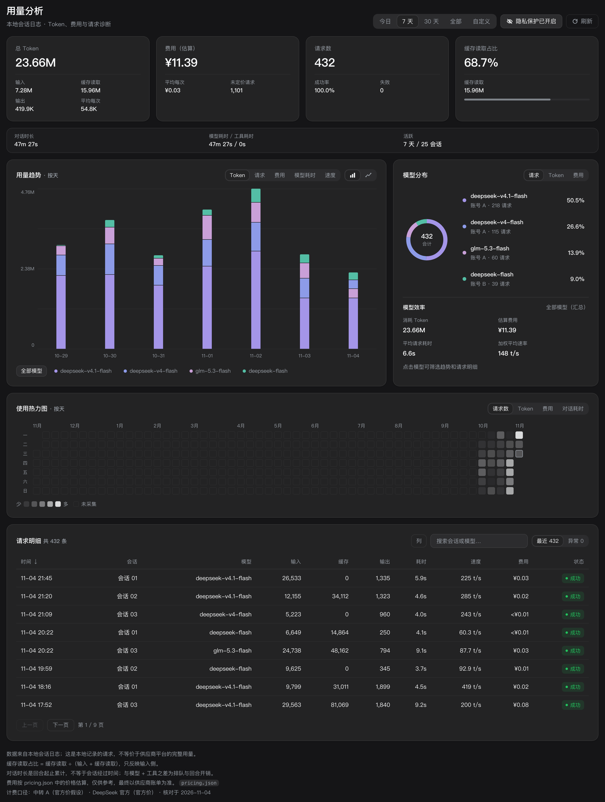
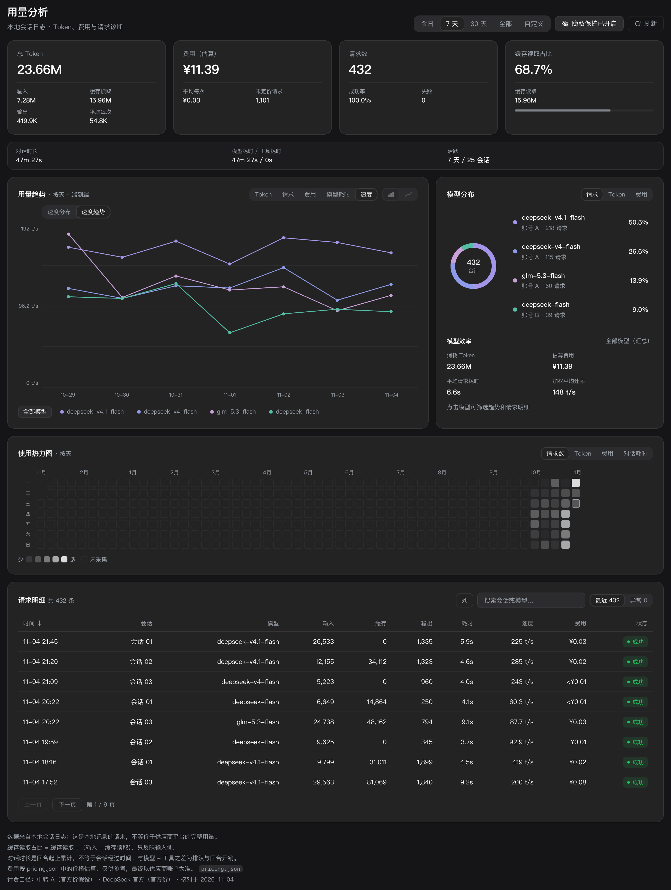
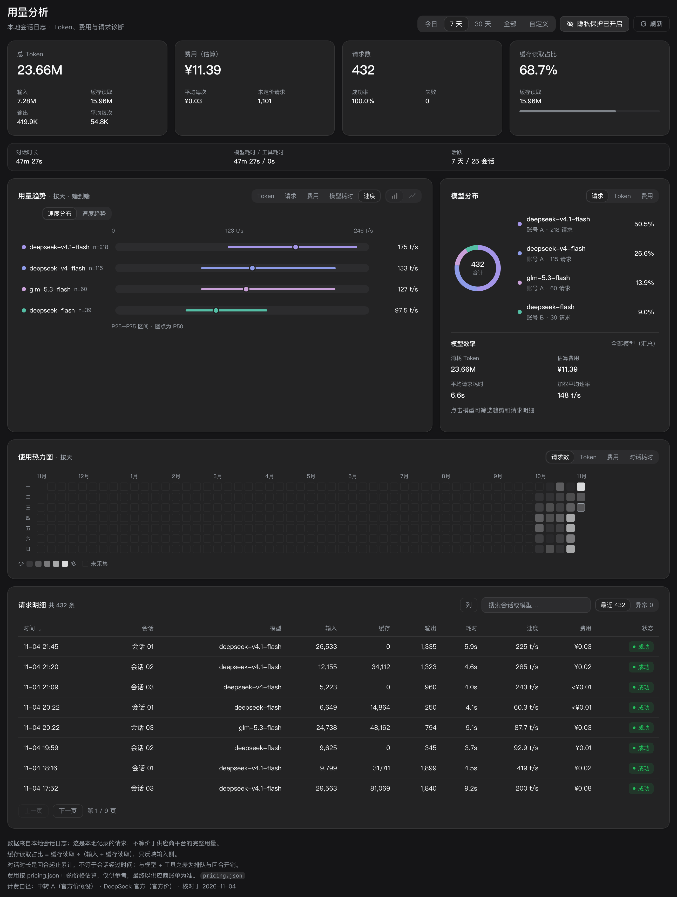

# TokenLens · 用量透镜

**把 DeepSeek Harness 的本地会话日志，变成一张能看懂的用量与费用看板。**

Token、请求、缓存命中、费用、模型速度、对话耗时——全部从本机日志算出来，不联网、不上传、不需要 API Key。

中文 | [English](README.en.md)

[](LICENSE)
[](#开发与打包)
[](https://github.com/muxili87-art/dsh-token-lens)
[](#隐私模式)



---

## 为什么需要它

Harness 默认只记录会话日志，不会告诉你：

- 今天/这周/这个月到底烧了多少 Token、花了多少钱；
- 缓存命中了多少——**命中率差 10 个点，账单能差一倍**；
- 哪个模型在吃预算，哪些请求其实走了高价档；
- 模型输出速度（tok/s）到底是快是慢，P50 掉到哪儿去了；
- 哪几天干得多、哪几天在空转。

这个插件把这些问题一次性答完：侧边栏点一下，趋势、热力图、模型分布、请求明细全在一起。

## 功能

| | |
|---|---|
| **多口径总览** | 今天 / 7 天 / 30 天 / 全部 / 自定义区间，KPI 卡直观对比 |
| **趋势图** | Token、请求、费用、模型耗时、输出速度五种指标；柱状/折线切换；模型筛选 |
| **自动聚合粒度** | 今天→按小时；7/30 天→按天；更长区间自动按周（周一起算）或按月，绝不糊成一根柱 |
| **GitHub 风格热力图** | 近 53 周每天一格，按请求/Token/费用/耗时着色；色阶随主题自动翻转（浅色主题越深＝用得越多），点格子即筛选当天 |
| **模型分布** | 按请求/Token/费用/耗时排名的彩色占比条，点图例即筛选 |
| **速度面板** | 速度分布（P25/P50/P75 区间）与速度趋势折线，多模型对比一眼看清 |
| **可检索请求明细** | 按时间/耗时/Token 排序，支持模型与关键词搜索，失败请求有独立视图 |
| **隐私模式** | 一键隐藏会话名、账号、错误详情与敏感模型名，数字不变——适合截图与共享 |
| **峰谷计价 + 内置价目表** | 按北京时间工作日高峰/低谷两档估算；默认带 DeepSeek / OpenAI / Anthropic / Gemini 公开价目，按模型名自动匹配 |

## 界面

### 模型耗时（全部模型时按模型分段堆叠，和 Token 趋势同宽度，不横向滚动）


### 速度趋势（多模型用折线对比，筛选单个模型后可切换柱状）



### 速度分布（P25 / P50 / P75）



## 安装

前置：DeepSeek Harness 桌面版（开发与验证版本 `0.2.1-rc.5`）。

1. 下载 [Release](https://github.com/muxili87-art/dsh-token-lens/releases) 里的 `dsh-token-lens-<version>.zip`，解压到任意目录并记下**绝对路径**；
2. 在 Harness 会话里执行：

```text
plugin_manager install_bundle target=<解压后的绝对路径>
```

3. 完全退出并重新打开 DeepSeek Harness（首次加载/替换插件必须重启，浏览器半的客户端模块才会重新组装）；
4. 左侧边栏出现「用量分析」图标，点击进入。

安装后数据自动计算：插件会在后台扫描 `~/.dsh/sessions`，增量折叠成按天桶并缓存到 `~/.dsh/usage-dashboard/cache.v1.json`，之后每次打开只做增量更新。

### 装完应用起不来怎么办

**v1.0.0 的 zip 是坏的，请勿使用**：它的 `package.json` 漏了 `exports["./client"]`，Harness 启动扫描会直接抛错、整个插件组装链失败，应用打不开。请升级到 **v1.0.1 或更新**。

如果装完任何版本都起不来，按这个顺序排查：

1. 打开插件目录，执行自检：

```bash
npm run doctor
```

   `✗ 声明了 dsh.client，但 package.json 没有 exports 映射` 就是上面那个问题（改用 v1.0.1+）；
2. 先卸载再重装：把 `~/.dsh/profiles/<profile>/node_modules/dsh-token-lens` 删掉、`cordis.patch.yml` 里对应的行删掉，重启确认应用恢复，再重新 `install_bundle`；
3. 仍失败时把 Harness 启动日志里 `client-modules:` 开头的报错发到 [Issues](https://github.com/muxili87-art/dsh-token-lens/issues)。

### Windows 说明

插件本身与操作系统无关（路径全部走 `homedir()` / `path.join`，没有平台专用代码）。Windows 上如果**从命令行启动** Harness 后它静默退出，通常不是插件问题，而是环境变量同时存在 `HTTPS_PROXY` 和 `https_proxy`（大小写重复）：清掉其中一个，或直接双击桌面图标启动即可。

## 隐私模式

点右上角「隐私模式」后：

- 会话标题 → `会话 01`、`会话 02`……（同一次打开的映射稳定，可对照）；
- 账号 → `账号 A`、`账号 B`……；
- 错误信息、搜索关键词 → 隐藏；
- 形如 `/Users/...`、`https://...`、`sk-...` 的敏感模型名 → `模型已隐藏`。

**统计数字、图表、费用一分不变**——所以可以直接截图发群、贴 issue。

> 插件本身只读本机会话日志，全部计算在本地完成，没有任何网络请求；这份 README 里的截图就是用隐私模式 + 示例数据渲染的。

## 计价（`pricing.json`）

**开箱即用**：内置一份通用价目表，没配置过的模型会按**模型名**自动匹配估算，不必一上手就填价格。

匹配顺序：`providers.<名字>` 精确命中 → 用该 provider 的价目表；否则按 `fallbacks` 用模型名匹配（`openai/gpt-4o` 与 `gpt-4o` 都认）；都没有才算「未定价」。**`providers` 永远优先于内置价目表**，配了自己的价格就按自己的算。

内置覆盖（整理自各家公开标价，**仅供估算**）：

| 家族 | 模型 |
|---|---|
| DeepSeek 官方 | `deepseek-flash` / `deepseek-chat` / `deepseek-reasoner`（含峰谷价）、`glm-5.3-flash` |
| OpenAI | `gpt-5`、`gpt-5-mini`、`gpt-4.1`、`gpt-4.1-mini`、`gpt-4.1-nano`、`gpt-4o`、`gpt-4o-mini`、`o3`、`o4-mini` |
| Anthropic | `claude-opus-4`、`claude-sonnet-4`、`claude-3-7-sonnet`、`claude-3-5-haiku` |
| Google | `gemini-2.5-pro`、`gemini-2.5-flash`、`gemini-2.0-flash` |

第三方中转、改过名的自定义模型不在内置范围内——按下面的格式自己加，或改 `fallbacks`。

```jsonc
{
  "fx": { "USD": 7.2 },            // 非人民币价目按此汇率折算成人民币显示
  "peak": {                         // 峰谷时段（北京时间）
    "offsetMinutes": 480,
    "weekdays": [1, 2, 3, 4, 5],
    "windows": [["09:00", "12:00"], ["14:00", "18:00"]]
  },
  "books": {                        // 价目表
    "openai-usd": {
      "currency": "USD",            // 该表的计价货币
      "source": "OpenAI 公开价目",
      "note": "仅供估算，可在 pricing.json 覆盖。",
      "models": {
        "gpt-4o": { "offPeak": { "cacheHit": 1.25, "cacheMiss": 2.5, "output": 10 } }
      }
    }
  },
  "providers": {                    // 精确映射，优先级最高
    "official": {
      "label": "DeepSeek 官方",
      "book": "deepseek-official",
      "source": "official",
      "models": { "deepseek-flash": "deepseek-flash" }
    }
  },
  "fallbacks": [                    // 模型名兜底匹配，从上到下第一个命中
    { "match": "gpt-4o-mini", "book": "openai-usd", "model": "gpt-4o-mini", "label": "OpenAI 通用价目" },
    { "match": "gpt-4o", "book": "openai-usd", "model": "gpt-4o", "label": "OpenAI 通用价目" }
  ]
}
```

要点：

- `providers.<p>` 的 key 必须和会话日志里 `provider/model` 的前半段一致，匹配不到才走 `fallbacks`；
- `fallbacks[].match` 默认**前缀匹配**（`mode` 可设为 `prefix` / `contains` / `exact`），会依次比对 `model`、`provider/model` 和模型名最后一段，所以 `gpt-4o-mini` 要写在 `gpt-4o` 之前；
- `books.<b>.currency` 不是 `CNY` 时按 `fx` 折算，界面统一显示人民币；
- 只有 `offPeak` 一档的模型（多数海外模型没有峰谷价）在高峰时段按同一档计算；
- 价格未确认的历史请求（早于 `effectiveFrom`）会在页脚标注，不会硬算；
- 用内置价目估算的模型会在页脚单独标注「按内置通用价目表估算」，不会被误当成账单金额。

## 指标口径

| 指标 | 定义 |
|---|---|
| 总 Token | `input + output + cacheRead + cacheWrite` |
| 请求数 | 成功发出的模型请求数（失败单列） |
| 缓存命中率 | `cacheRead / (cacheRead + input)` |
| 费用 | `cacheRead×cacheHit + (input+cacheWrite)×cacheMiss + output×output`，按峰谷档与 provider 映射计算 |
| 模型耗时 | 该模型请求的 LLM 平均耗时（不含工具调用） |
| 输出速度 | `output tokens / (耗时 ms / 1000)`，逐请求取样本后算 P25/P50/P75 |

## 趋势聚合粒度

| 范围 | 粒度 |
|---|---|
| 今天 | 按小时 |
| 7 天 / 30 天 | 按天 |
| 全部 / 自定义 | 跨度 ≤1 天→按小时；≤45 天→按天；≤315 天→按周（周一锚定）；更长→按日历月 |

周桶从区间内第一个周一完整铺到最后一个周一；月桶按统计时区的自然月切分；速度的 P50 在每个桶内用请求级样本重新计算，不是「日 P50 的平均」。

## 数据来源与准确性

- **唯一数据源**是 `~/.dsh/sessions/<workspace>/<session>/session.v*.jsonl.zstd` 会话日志，插件只读不写；
- 统计的是**本地记录的用量**，与供应商账单可能有出入（重试、失败请求、缓存计费口径、免费额度等）；
- fork/副本会话的「播种」请求会去重，避免同一份历史被算两遍；
- 缓存文件可随时删除，下次打开会全量重建。

## 开发与打包

零运行时依赖（只用 Node 内建与 Harness 自带包），改完直接跑：

```bash
npm run check    # 三个 JS 文件的语法检查
npm run doctor   # 校验 bundle 契约（dsh.client / exports / patch 行名 / 模块 id）
npm run verify   # 上面两步一起
npm run pack     # 生成 dist/dsh-token-lens-<version>.zip
```

> `npm run doctor` 复刻宿主 `client-modules` 的启动校验。**发布前必须通过**：
> 只要 `dsh.client` 缺了 `exports["./client"]`，Harness 启动扫描就会抛
> `declares dsh.client but exports no "./client" bundle`，整个插件组装链失败、应用起不来
> —— v1.0.0 就是这么翻车的。CI 每次 push 也会跑这两个检查。

结构：

| 文件 | 作用 |
|---|---|
| `index.js` | Host 半：扫描/折叠会话日志，注册两个鉴权路由 |
| `fold.js` | 折叠与聚合核心：分桶、峰谷计价、速度分位 |
| `client.js` | Web 半：侧边栏图标与看板页面（React） |
| `pricing.json` | 计价配置 |
| `cordis.patch.yml` | 插件行（bundle patch） |
| `locale/*.json` | 插件标题与描述（中/英） |

路由（均需 Harness 会话鉴权）：

- `GET /usage-dashboard/summary?from&to&tz&mode`
- `GET /usage-dashboard/requests?from&to&tz&view&sort&order&offset&limit&model&q`

## License

[MIT](LICENSE)
